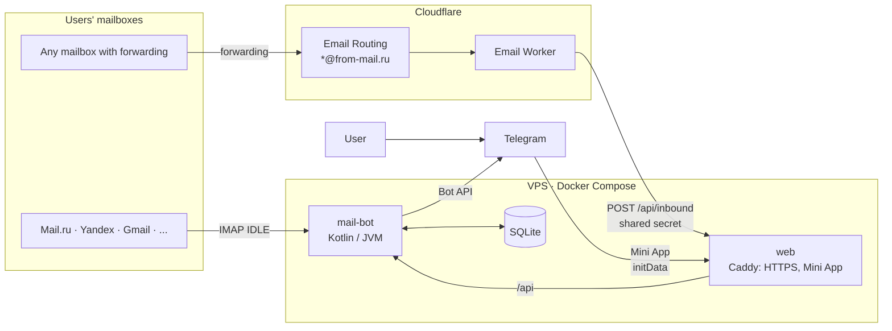

# Mail to Telegram

**English** · [Русский](README.ru.md)


A Telegram bot that delivers new emails from your mailboxes to Telegram within seconds. It comes with a Mini App inside Telegram to connect mailboxes, read and search mail, set up filters and manage the subscription.

**Live bot:** [@FromMailBot](https://t.me/FromMailBot) · **Mini App:** opens with the "Open" button in the bot

Works with Mail.ru (and list.ru, bk.ru, inbox.ru), Yandex, Gmail, Rambler, iCloud and any mailbox with IMAP access. There is also a **passwordless mode**: the user sets up forwarding to a personal bot address in their mail settings.

---

## Contents

- [For recruiters, in brief](#for-recruiters-in-brief)
- [Features](#features)
- [How it works](#how-it-works)
- [Engineering highlights](#engineering-highlights)
- [Security](#security)
- [Tech stack](#tech-stack)
- [Project structure](#project-structure)
- [Tests and quality](#tests-and-quality)
- [Self-hosting](#self-hosting)
- [Configuration](#configuration)
- [Bot commands](#bot-commands)
- [Limitations](#limitations)
- [License](#license)

---

## For recruiters, in brief

| | |
|---|---|
| **What it is** | A production service: a bot plus a web app inside Telegram, running on a VPS with real users and payments |
| **Author's role** | Solo full-cycle developer: idea, UI design, backend, frontend, infrastructure, payments, analytics, support |
| **Size** | ≈ 16,500 lines of Kotlin (backend), ≈ 6,400 lines of TypeScript/React (Mini App), ≈ 2,200 lines of tests (100+ tests) |
| **Backend** | Kotlin, coroutines, Ktor (HTTP server and client), IMAP/SMTP (Jakarta Mail), SQLite |
| **Frontend** | React 19, TypeScript, Vite, Telegram Mini Apps API |
| **Infrastructure** | Docker Compose, Caddy (automatic HTTPS), Cloudflare Email Routing and Workers, health monitoring |
| **Payments** | Telegram Stars subscriptions: monthly with auto-renewal, yearly, free trial, refunds, referral program |
| **What it demonstrates** | Asynchronous event processing, reliable delivery (outbox), external protocols, cryptography, SSRF and XSS protection, product analytics (funnel), admin panel |

---

## Features

### Email notifications
- A card for every new email: mailbox, sender, subject, date, attachments. It usually arrives 3–15 seconds after the email.
- Buttons under the card:
  - 📱 **Open**: the full email in the Mini App;
  - 📄 **Text**: the full text right in the chat;
  - 📎 **Attachments**: files to the chat;
  - ✅ **Read**: mark the email as read in the mailbox itself;
  - 📋 **Copy code**: copy a verification code from the email in one tap (Pro);
  - 🚫 **Unsubscribe**: leave a mailing list (Pro), see below.
- Old emails are never forwarded, only mail that arrives after the mailbox is connected.
- If a mailbox stops working (for example, the app password was revoked), the bot explains what happened and how to fix it, and reports when it works again.

### Two ways to connect a mailbox
1. **App password (IMAP).** The user enters the address, the app detects the provider and shows step-by-step instructions for creating an app password with that provider. The password is stored encrypted.
2. **Passwordless forwarding.** The bot issues a personal address like `xxxx@from-mail.ru`, and the user turns on forwarding to it. Mail goes through Cloudflare Email Routing and an Email Worker to the bot server. The bot never needs the mailbox password.

### Mini App (inside Telegram)
- Mailbox list with status: working, connecting, paused (with "until 18:30") or the exact error.
- A custom dark theme with an animated starfield and a light theme in Telegram colors. Russian and English UI.
- **Mail:** Inbox and Sent of every mailbox, "Unread", "With attachments" and "★ Starred" filters, sorting.
- **Search across all mailboxes:** results appear as each mailbox answers, so a slow mailbox does not hold up the rest.
  - First the mail server searches instantly. For Gmail this is Gmail's own search, the same as on the web.
  - Then the bot scans recent emails for partial-word matches (for example, "discou").
- **Full email:**
  - a formatted view like in a mail client: sanitized HTML in an isolated frame, remote images load only on request;
  - a plain-text view.
- **Attachments:**
  - images and PDFs open full screen;
  - files download through Telegram's native dialog;
  - "Share" opens Telegram's chat picker.
- **Stars** on emails and "mark as unread" right in the mailbox.
- **Mailbox settings:**
  - pause for a chosen time, picked on an iPhone-style wheel;
  - notification sound;
  - a delivery test;
  - app password change;
  - disconnect.

### Filters (per mailbox)
- ⭐ **Important senders:** their emails always arrive: during a pause, past other filters, right away and with sound even in quiet hours.
- Skip newsletters and auto-replies (detected by `List-Unsubscribe`, `List-Id`, `Precedence`, `Auto-Submitted`).
- Only from selected addresses or domains.
- Never from selected addresses or domains (subdomains included).
- Skip emails whose subject contains given words.

### One-tap unsubscribe
- If the mailing list supports one-click unsubscribe (RFC 8058), the bot unsubscribes by itself.
- Otherwise it sends a button with the unsubscribe page.
- The bot only calls public https addresses: a link from someone else's email cannot make it reach the server's internal network.

### Notification modes (per user)
- **Quiet hours:** emails arrive silently at night, in the user's time zone.
- **Digest:** emails are collected and delivered every 1, 3, 6, 12 or 24 hours.
- **Silent mailbox:** one mailbox always arrives without sound.

### Group chats (Business)
A mailbox can deliver to a team group chat. Buttons under emails work for every member. Reply and unsubscribe stay with the mailbox owner.

### Plans and Telegram Stars payments
| | Free | Pro | Business |
|---|---|---|---|
| Mailboxes | 1 | 5 | 15 |
| Notifications, pause, quiet hours, digest | ✓ | ✓ | ✓ |
| Recent emails in the app | 20 | all | all |
| Search, Sent folder, filters, important senders | | ✓ | ✓ |
| Verification codes, one-tap unsubscribe | | ✓ | ✓ |
| Delivery to a group chat | | | ✓ |

- The monthly plan renews automatically. Auto-renewal can be turned off right in the app and back on until the period ends. The yearly plan is a one-time payment.
- Pro trial for new users. Two days before it ends, the bot sends a summary: how many emails it delivered, what changes on Free, and a payment button.
- Referral program: a month of Pro for every N friends who connect a mailbox.
- Invite links with a subscription, granting and revoking plans, Stars refunds.

### Admin panel (the "Admin" tab in the app, admins only)
- **Overview:** users, share who connected a mailbox, paying users, system health, event feed.
- **People:** search by ID, @username and name, filters (paid, Free, no mailbox, with errors).
- **User card:**
  - subscription, mailboxes and funnel path;
  - grant Pro or Business for any term;
  - reset the trial;
  - revoke with or without a refund;
  - delete the user's data.
- **Funnel:** from bot start to payment, by traffic source (`t.me/bot?start=src_habr`), popular mail providers, connection errors, who got stuck.
- **System:** broken mailboxes, delivery stats, mail servers, one-tap backup.
- **Money:** revenue, subscriptions, recent payments, invite links for any term.
- **Broadcast:** text, audience (all, with mailbox, without mailbox, paid, trial, Free), test send to yourself, confirmation, result report in the chat.

### For the service owner
- `/health` endpoint for external monitoring (UptimeRobot and similar).
- Daily database backup, sent to the admins as a file.
- The bot sets its own description and commands in Telegram in two languages.
- Users can delete all their data with one command.

---

## How it works



**An email over IMAP**
1. `ImapIdleWatcher` keeps an IMAP IDLE connection to every mailbox, so the server pushes new mail. For providers that report mail late over IDLE (Gmail), there is a safety check over the same connection.
2. New UIDs go through the mailbox filters. Important senders always pass.
3. The notification is written to an **outbox** table in SQLite and only then sent. If Telegram is unavailable or the server restarts, nothing is lost: workers retry with growing delays.
4. A fast card built from headers goes out first. Then the bot fetches the full email and enriches the card with the verification code, attachment and unsubscribe buttons.

**An email via forwarding**
The Cloudflare Email Worker receives mail for `token@from-mail.ru` and posts it to `/api/inbound` with a shared secret. The bot finds the mailbox by token and keeps the email for 7 days so the Text and Attachments buttons work. From there the path is the same: filters, outbox, card.

**Mini App**
Caddy serves the React app. Requests to `/api` reach the bot with Telegram's signed user data (`initData`). The server verifies the HMAC-SHA256 signature with the bot token and knows who is calling, with no logins or passwords.

---

## Engineering highlights

- **Reliable delivery (transactional outbox).** Every notification is persisted before it is sent. Several workers retry with exponential backoff, and dead notifications show up in the admin panel. No email is lost on Telegram outages, network errors or restarts.
- **IMAP IDLE push plus a safety net.** One persistent connection per mailbox instead of constant polling. Reconnects use exponential backoff.
- **Kotlin coroutines.** Hundreds of mailboxes are served concurrently, and a slow mail server never blocks the others. Blocking IMAP runs on `Dispatchers.IO`, and every operation has a timeout.
- **Two-phase search.**
  - First the mail server's own search runs: instant and across the whole mailbox. For Gmail it uses the `X-GM-RAW` extension, the same search as on the web.
  - Then the bot scans recent emails for partial-word matches. It reads only the needed headers, in growing batches, within a time budget, and returns a cursor to continue.
  - A slow mailbox (Mail.ru serves messages dozens of times slower than Gmail) does not delay the others.
- **Safe HTML email rendering.**
  - The server sanitizes HTML with a jsoup Safelist: scripts, forms and handlers are removed, and inline `cid:` images become `data:` URIs.
  - The app renders the email in a script-less `iframe sandbox` with its own CSP, so remote images (tracking pixels) load only on request.
  - Links are intercepted and opened outside the app.
- **Attachment downloads via signed links.** Telegram downloads the file itself, without user data. So access is encoded in a short-lived HMAC-SHA256 token: owner, mailbox, email, attachment index, 15-minute expiry. Active types (HTML, SVG, scripts) are only served as downloads, with `nosniff` and CSP `sandbox`.
- **Share through Telegram.** The file is uploaded to Telegram once, the service message is deleted right away, and the `file_id` is reused. `savePreparedInlineMessage` plus `WebApp.shareMessage` give the native chat picker.
- **Telegram Stars subscriptions.** Handles `pre_checkout_query` and `successful_payment`, monthly renewals, turning auto-renewal off and back on (`editUserStarSubscription`), refunds (`refundStarPayment`), and a grace hour for late renewals.
- **Product analytics.** A step funnel (start, app opened, provider chosen, connected, first email, trial, payment) broken down by traffic source shows where users drop off.
- **Localization.** All bot and app texts in Russian and English. The language follows Telegram or is chosen manually.

---

## Security

| Threat | Protection |
|---|---|
| Mailbox passwords leaking from the database | AES-256-GCM encryption; the key lives only in `.env`, never in the database or backups |
| Forged API requests on behalf of another user | Every request is signed by Telegram (`initData`, HMAC-SHA256 with the bot token) and checked for age; users only see their own mailboxes |
| Forged forwarded emails | `/api/inbound` only accepts requests with the Cloudflare Worker's shared secret; mailbox addresses are random tokens |
| SSRF: making the server call internal networks | Mail servers and unsubscribe links in private, loopback and reserved ranges are rejected (IPv4 and IPv6); redirects are not followed |
| XSS via email HTML | Server-side sanitizing (jsoup), script-less `iframe sandbox`, CSP, links open outside the app |
| Access to other users' attachments | Signed 15-minute links bound to the owner and the email; the key is generated at startup |
| Malicious files served from the domain | Active content is only served as a download: `Content-Disposition: attachment`, `nosniff`, CSP `sandbox` |
| Admin functions | Only for IDs from `.env`; the server checks every request |
| Password guessing and flooding | Per-user rate limits: 300 API requests per minute, 10 mailbox logins and 10 test messages per 10 minutes (HTTP 429 with `Retry-After`) |
| Oversized requests | Caddy cuts request bodies: 1 MB for the API, 32 MB for forwarded emails |
| Browser-level attacks | HSTS, `nosniff`, `Referrer-Policy: no-referrer`, `Permissions-Policy`; CORS is off (the app and the API share one origin) |
| Data loss | Daily backups, an outbox that survives restarts, full user data deletion on request |

Secrets (`TELEGRAM_BOT_TOKEN`, `ENCRYPTION_KEY`, `INBOUND_SECRET`) live only in `.env` on the server and never reach the repository. The web container (Caddy) only receives `DOMAIN` and `OLD_DOMAIN`, not the whole `.env`.

---

## Tech stack

**Backend**
- Kotlin 2.3, JVM 21, kotlinx.coroutines, kotlinx.serialization
- Ktor 3: HTTP server (Netty) for the Mini App API, HTTP client (OkHttp) for the Telegram Bot API
- Jakarta Mail (Eclipse Angus): IMAP IDLE, search, SMTP; jsoup for HTML
- SQLite + HikariCP, no ORM: hand-written SQL, column migrations at startup
- Logback

**Frontend (Telegram Mini App)**
- React 19, TypeScript, Vite
- Telegram Mini Apps API: BackButton, themes, `downloadFile`, `shareMessage`, haptic feedback
- No UI library: custom Telegram-style components

**Infrastructure**
- Docker Compose: `mail-bot` (JVM) and `web` (Caddy with automatic Let's Encrypt certificates)
- Cloudflare: DNS, Email Routing and an Email Worker for the forwarding mode
- Monitoring: `/health` + UptimeRobot

---

## Project structure

```text
src/main/kotlin/io/github/lightsmit/
├── Main.kt          wiring and background jobs
├── api/             Mini App HTTP API, initData verification, signed file links
├── billing/         plans, Telegram Stars subscriptions, referrals, invoice links
├── config/          settings from .env, mailbox and filter model
├── i18n/            bot texts in Russian and English
├── mail/            IMAP (IDLE, listing, search, reading), SMTP, email parsing, HTML, unsubscribe, codes
├── security/        AES-256-GCM encryption
├── service/         forwarding, filters, outbox worker, schedules, admin panel, funnel,
│                    search, attachments, backups, mailbox health, data deletion
├── storage/         SQLite repositories
└── telegram/        Bot API client, button codec, network error handling
src/test/            unit tests
frontend/src/        Mini App: screens, components, API, i18n
deploy/              Caddyfile, Cloudflare Email Worker
```

---

## Tests and quality

- 100+ unit tests (`kotlin.test`, JUnit), covering:
  - subscriptions: renewals, auto-renewal, refunds, trial;
  - filters and important senders;
  - the funnel;
  - signed file links;
  - unsubscribe link parsing and internal address protection;
  - the button codec;
  - Telegram network error classification;
  - verification code extraction.
- Strict TypeScript type checking and ESLint for the frontend.
- The Docker build reproduces production exactly.

```bash
./gradlew test                                  # backend tests (Windows: .\gradlew test)
cd frontend && npm ci && npm run build          # type check and build the Mini App
```

---

## Self-hosting

**Requirements:** a VPS with Ubuntu 22.04/24.04, 1 GB RAM or more (2 GB swap recommended), ports 80 and 443 open, a domain (or the free `IP-with-dashes.sslip.io`), and a bot token from [@BotFather](https://t.me/BotFather).

```bash
curl -fsSL https://get.docker.com | sh
git clone https://github.com/LightSmit/mail-to-telegram-bot.git
cd mail-to-telegram-bot
cp .env.example .env
nano .env        # minimum: TELEGRAM_BOT_TOKEN, ENCRYPTION_KEY, DOMAIN, TELEGRAM_CHAT_ID
docker compose up -d --build
docker compose logs -f mail-bot
```

- Generate `ENCRYPTION_KEY` with `openssl rand -base64 48` and keep it in a password manager: without it, stored mailbox passwords cannot be decrypted.
- In @BotFather: `/mybots` → your bot → Bot Settings → Configure Mini App → `https://<DOMAIN>`.
- Forwarding mode:
  1. A domain on Cloudflare with Email Routing.
  2. A catch-all rule to the Worker from `deploy/cloudflare-email-worker.js`.
  3. The `INBOUND_DOMAIN` and `INBOUND_SECRET` variables.

**Update:** `git pull && docker compose up -d --build`.

---

## Configuration

All settings live in `.env` (commented in [.env.example](.env.example)).

| Variable | Default | Purpose |
|---|---|---|
| `TELEGRAM_BOT_TOKEN` | — | Bot token (required) |
| `ENCRYPTION_KEY` | — | Key for mailbox passwords, 32+ characters (required) |
| `DOMAIN` | — | Mini App domain (HTTPS via Caddy) |
| `OLD_DOMAIN` | — | Previous domain after a move: old buttons keep working |
| `CORS_ORIGINS` | — | Other sites allowed to call the API from a browser, comma separated (usually empty) |
| `MINI_APP_URL` | `https://<DOMAIN>` | Mini App URL, if different |
| `TELEGRAM_CHAT_ID` | — | Owner's ID, always an admin |
| `ADMIN_IDS` | — | More admins, comma separated |
| `BILLING_ENABLED` | `false` | Plans and Stars payments (while `false`, everyone has Pro limits) |
| `TRIAL_DAYS` / `TRIAL_MODE` | `7` / `button` | Pro trial: length, started by a button or automatically |
| `PRICE_PRO_MONTH` / `PRICE_PRO_YEAR` | `100` / `1000` | Pro prices in Stars |
| `PRICE_BUSINESS_MONTH` / `PRICE_BUSINESS_YEAR` | `300` / `3000` | Business prices in Stars |
| `REFERRAL_GOAL` | `5` | Friends needed for a month of Pro (0 - off) |
| `INBOUND_DOMAIN` / `INBOUND_SECRET` | — | Passwordless forwarding mode |
| `IMAP_SAFETY_POLL_SECONDS` | `15` | Mailbox safety check interval |
| `MAX_ATTACHMENT_SIZE_MB` | `45` | Larger attachments are not sent to Telegram |
| `BACKUP_HOUR` / `BACKUP_KEEP` | `4` / `7` | Daily backup hour and copies kept |
| `REPLY_ENABLED` | `false` | Reply from Telegram (needs open SMTP 465/587) |
| `SUPPORT_CONTACT` | — | Contact for payment questions |
| `TELEGRAM_PROXY_URL` | — | HTTP proxy for the Telegram Bot API only |

---

## Bot commands

| Command | Who | What it does |
|---|---|---|
| `/start` | everyone | Welcome and the "Open app" button |
| `/help` | everyone | How to connect a mailbox |
| `/mailboxes` | everyone | Your mailboxes and their status |
| `/language` | everyone | Bot language |
| `/premium` | everyone | Plan and payment |
| `/referral` | everyone | Invite link and friends counter |
| `/paysupport` | everyone | Payment questions |
| `/delete_my_data` | everyone | Delete all your data |
| `/admin`, `/stats`, `/users`, `/subs` | admins | Statistics, users, subscriptions |
| `/funnel`, `/stuck` | admins | New user funnel, who did not connect a mailbox |
| `/grant`, `/revoke`, `/refund`, `/invite` | admins | Subscription management |
| `/broadcast`, `/backup` | admins | Broadcast, backup |

The admin panel in the Mini App covers all of this and more.

---

## Limitations

- Outlook and Hotmail: Microsoft allows IMAP only with OAuth, so they cannot be connected with an app password. The forwarding mode works with them.
- Search covers subject, sender and recipient. The mail server's own search finds whole words, and the bot finds partial words itself. With Mail.ru this is slower because the provider serves messages for scanning slowly.
- Replying from Telegram needs open outgoing SMTP ports. Many hosting providers block them, so the feature is off by default.

---

## License

Proprietary, all rights reserved. Use, copying or distribution requires the author's written permission, see [LICENSE](LICENSE).

© 2026 Matvey ([LightSmit](https://github.com/LightSmit))
