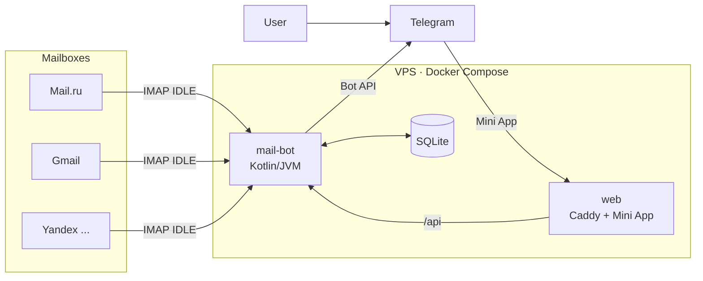

# Mail to Telegram Bot

**English** · [Русский](README.ru.md)

A Telegram bot that forwards new emails from your mailboxes to a Telegram chat within seconds. Users connect mailboxes themselves in a Telegram Mini App: no passwords in chat, no config files, several mailboxes per person.

Works with Mail.ru (and list.ru, bk.ru, inbox.ru), Yandex, Gmail, Rambler, iCloud and any other mailbox with IMAP access.

## Features

**Notifications**
- A card for every new email: mailbox, sender, subject, date, attachments.
- Buttons under the card: 📄 full text, 📎 attachments as files, ✅ mark as read in the mailbox.
- New mail is detected through IMAP IDLE (push) with a safety check every 15 seconds. Typical delay is 5–15 seconds.
- Old emails are never forwarded, only mail that arrives after the mailbox is connected.

**Mini App (inside Telegram)**
- Connect a mailbox: enter the address, the provider is detected automatically, step-by-step instructions for creating an app password are shown for each provider.
- Mailbox status: working, connecting, or the exact problem (for example, the app password was revoked).
- Update the app password without reconnecting the mailbox: filters and position are kept.
- **Mail browser:** Inbox and Sent of every connected mailbox, server-side search by subject, sender and recipient, "unread" and "with attachments" filters, sorting, reading emails, marking as read, sending attachments to the chat. Emails are read from the mailbox on request and are not stored on the server.
- Light and dark themes follow the Telegram theme.
- Russian and English interface: the bot and the Mini App follow the user's Telegram language. Admin commands are in Russian.

**Filters (per mailbox)**
- Pause.
- Skip newsletters and auto-replies (detected by `List-Unsubscribe`, `List-Id`, `Precedence`, `Auto-Submitted`).
- Only from: a list of addresses or domains.
- Never from: a list of addresses or domains (subdomains included).
- Skip emails whose subject contains given words.

**Notification modes (per user)**
- Quiet hours: emails arrive silently at night, in the user's time zone.
- Digest: emails are collected and delivered together every 1, 3, 6, 12 or 24 hours.

**For the owner**
- `/admin` — users, mailboxes, notifications sent, queue health.
- `/broadcast` — message to all users with a preview and confirmation.
- `/backup` and an automatic daily SQLite backup sent to the admins.
- Alerts to the user when a mailbox stops working, and a message when it recovers.

**Reliability and security**
- Notifications go through a persistent outbox in SQLite: nothing is lost on restart or Telegram errors, with retries and backoff.
- Mailbox passwords are encrypted with AES-256-GCM. The key lives only in `.env`.
- Mini App requests are authenticated by Telegram `initData` signature verification; each user sees only their own mailboxes.
- IMAP servers in private networks are rejected (no SSRF into the server).
- Users can delete all their data at any time: `/delete_my_data` in the bot or "My data" in the Mini App.

**Prepared but disabled by default**
- Reply to an email from Telegram via SMTP (`REPLY_ENABLED=true`). Many hosting providers block outgoing SMTP ports 465 and 587; enable it only on a server where they are open.

## How it works



- **mail-bot** watches mailboxes, delivers notifications, handles buttons and commands, and serves the API for the Mini App.
- **web** is Caddy with an automatic HTTPS certificate: it serves the Mini App and proxies `/api` to the bot.

## Requirements

- A VPS with Ubuntu 22.04/24.04, **1 GB RAM** or more (2 GB of swap recommended), ports 80 and 443 open.
- A domain, or the free `sslip.io` name based on the server IP (for example `203-0-113-10.sslip.io`).
- A bot token from [@BotFather](https://t.me/BotFather).

## Quick start (about 15 minutes)

**1. Create the bot.** In @BotFather: `/newbot`, copy the token.

**2. Prepare the server.**
```bash
curl -fsSL https://get.docker.com | sh
git clone https://github.com/LightSmit/mail-to-telegram-bot.git
cd mail-to-telegram-bot
cp .env.example .env
```

**3. Fill in `.env`.** The minimum is:
```dotenv
TELEGRAM_BOT_TOKEN=123456:ABC...
ENCRYPTION_KEY=        # openssl rand -base64 48
DOMAIN=203-0-113-10.sslip.io
TELEGRAM_CHAT_ID=      # your Telegram user ID: you become the admin
```
Keep a copy of `ENCRYPTION_KEY` in a password manager. Without it, stored mailbox passwords cannot be decrypted.

**4. Start.**
```bash
docker compose up -d --build
docker compose logs -f mail-bot
```
The first build takes 2–4 minutes.

**5. Connect the Mini App.** In @BotFather: `/mybots` → your bot → `Bot Settings` → `Menu Button` → `https://<DOMAIN>`.

**6. Check.** Send `/start` to the bot, open the app, connect a mailbox and send yourself an email.

## Configuration

All settings live in `.env` (see [.env.example](.env.example)).

| Variable | Default | Purpose |
|---|---|---|
| `TELEGRAM_BOT_TOKEN` | — | Bot token, required |
| `ENCRYPTION_KEY` | — | Key for mailbox passwords (32+ characters), required |
| `DOMAIN` | — | Mini App domain for Caddy and the "Open app" button |
| `MINI_APP_URL` | `https://<DOMAIN>` | Explicit Mini App URL, if it differs |
| `TELEGRAM_CHAT_ID` | — | Owner's Telegram ID, always an admin |
| `ADMIN_IDS` | — | More admins, comma separated |
| `MAX_MAILBOXES_PER_USER` | `5` | Mailbox limit per user |
| `IMAP_SAFETY_POLL_SECONDS` | `15` | Safety check over a fresh connection (each check is a new login) |
| `IMAP_NOOP_SECONDS` | `5` | NOOP over the open IDLE connection |
| `IDLE_RECONNECT_DELAY_SECONDS` | `5` | Base reconnect delay (exponential backoff on errors) |
| `MAX_ATTACHMENT_SIZE_MB` | `45` | Larger attachments are not sent to Telegram |
| `BACKUP_HOUR` / `BACKUP_KEEP` | `4` / `7` | Hour of the daily backup and number of copies kept |
| `BACKUP_SEND_TO_ADMINS` | `true` | Send the daily backup file to admins |
| `REPLY_ENABLED` | `false` | "Reply" button (needs open outgoing SMTP 465/587) |
| `TELEGRAM_PROXY_URL` | — | HTTP proxy for Telegram Bot API only, if Telegram is blocked |
| `ENCRYPTION_KEY_LEGACY` | — | Previous key, only for migrating old records |

## Bot commands

| Command | Who | What it does |
|---|---|---|
| `/start` | everyone | Welcome and the "Open app" button |
| `/help` | everyone | How it works and how to connect a mailbox |
| `/mailboxes` | everyone | Your mailboxes and their status |
| `/delete_my_data` | everyone | Delete all your data from the bot (with confirmation) |
| `/admin`, `/stats` | admins | Statistics |
| `/broadcast text` | admins | Prepare a broadcast; `/broadcast_send` sends it, `/broadcast_cancel` cancels |
| `/backup` | admins | Make a database backup now |

## Updating and backups

```bash
git pull
docker compose up -d --build
```

A database backup is made every day automatically. A manual copy of the data volume:
```bash
docker run --rm -v mail-to-telegram-bot_mail-bot-data:/data -v "$PWD":/backup alpine \
  tar czf /backup/mail-bot-data-$(date +%F).tar.gz /data
```

## Development

- Backend: Kotlin 2, JVM 21, Ktor (server and client), Jakarta Mail (Angus), SQLite + HikariCP, kotlinx.coroutines, jsoup.
- Frontend: React 19, TypeScript, Vite, `@twa-dev/sdk`.
- Infrastructure: Docker Compose, Caddy.

```bash
./gradlew test        # tests (Windows: .\gradlew test)
./gradlew run         # run the bot locally with .env from the project folder
cd frontend && npm ci --legacy-peer-deps && npm run dev
```

```text
src/main/kotlin/io/github/lightsmit/
├── api/        Mini App HTTP API, Telegram initData verification
├── config/     configuration, mailbox model
├── mail/       IMAP (IDLE, fetching, search), SMTP, email parsing
├── security/   AES-256-GCM password encryption
├── service/    forwarding, filters, schedule, admin, backups, health
├── storage/    SQLite repositories, outbox
└── telegram/   Bot API client, button codec
frontend/       Mini App (React)
deploy/         Caddyfile
```

## Limitations

- Gmail sometimes reports new mail late over IMAP; with `IMAP_SAFETY_POLL_SECONDS=15` the delay is about 10–15 seconds. Instant delivery would require the Gmail API with OAuth.
- Outlook / Hotmail are not supported: Microsoft allows IMAP only with OAuth.
- Mail search works on subject, sender and recipient (the mail server's IMAP SEARCH), not on the email text.
- Replying from Telegram needs outgoing SMTP; see `REPLY_ENABLED`.

## License

Proprietary, all rights reserved. Use, copying or distribution requires written permission of the author, see [LICENSE](LICENSE).

© 2026 Matvey ([LightSmit](https://github.com/LightSmit))
