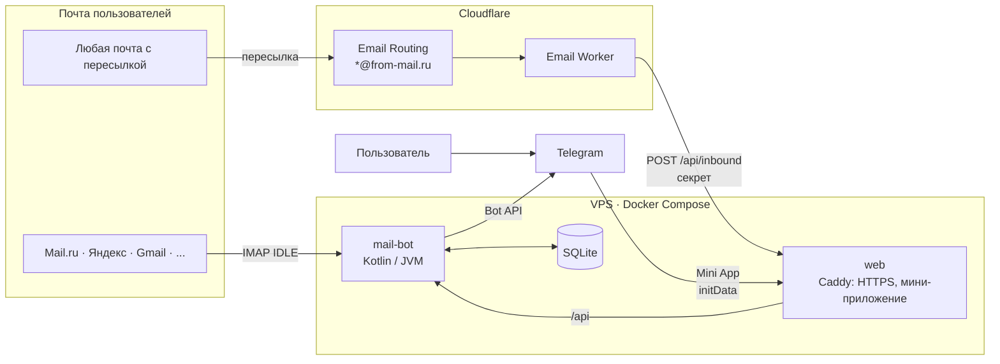

# Mail to Telegram

[English](README.md) · **Русский**


Telegram-бот, который за секунды присылает новые письма из ваших почтовых ящиков в Telegram. Для управления у него есть мини-приложение прямо внутри Telegram: подключение ящиков, просмотр почты, поиск, фильтры и подписка.

**Живой бот:** [@FromMailBot](https://t.me/FromMailBot) · **Мини-приложение:** открывается кнопкой «Открыть» в боте

Работает с Mail.ru (а также list.ru, bk.ru, inbox.ru), Яндексом, Gmail, Rambler, iCloud и любой почтой с доступом по IMAP. Есть и режим **без пароля**: пользователь настраивает в своей почте пересылку на личный адрес бота.

---

## Содержание

- [Коротко для HR](#коротко-для-hr)
- [Возможности](#возможности)
- [Как это устроено](#как-это-устроено)
- [Технические решения](#технические-решения)
- [Безопасность](#безопасность)
- [Стек](#стек)
- [Структура проекта](#структура-проекта)
- [Тесты и качество](#тесты-и-качество)
- [Запуск на своем сервере](#запуск-на-своем-сервере)
- [Настройки](#настройки)
- [Команды бота](#команды-бота)
- [Ограничения](#ограничения)
- [Лицензия](#лицензия)

---

## Коротко для HR

| | |
|---|---|
| **Что это** | Сервис уровня продукта: бот и веб-приложение внутри Telegram, работают в продакшене на VPS с реальными пользователями и оплатой |
| **Роль автора** | Один разработчик полного цикла: идея, дизайн интерфейса, бэкенд, фронтенд, инфраструктура, оплата, аналитика, поддержка |
| **Объем** | ≈ 16 500 строк Kotlin (бэкенд), ≈ 6 400 строк TypeScript/React (мини-приложение), ≈ 2 200 строк тестов (100+ тестов) |
| **Бэкенд** | Kotlin, корутины, Ktor (HTTP-сервер и клиент), IMAP/SMTP (Jakarta Mail), SQLite |
| **Фронтенд** | React 19, TypeScript, Vite, Telegram Mini Apps API |
| **Инфраструктура** | Docker Compose, Caddy (автоматический HTTPS), Cloudflare Email Routing и Workers, мониторинг через `/health` |
| **Деньги** | Подписки за Telegram Stars: месячные с автопродлением, годовые, пробный период, возвраты, реферальная программа |
| **Что показывает** | Асинхронная обработка событий, надежная доставка (outbox), работа с внешними протоколами, криптография, защита от SSRF и XSS, продуктовая аналитика (воронка), админ-панель |

---

## Возможности

### Уведомления о письмах
- Карточка на каждое новое письмо: ящик, отправитель, тема, дата, вложения. Обычно приходит через 3–15 секунд после письма.
- Кнопки под карточкой:
  - 📱 **Открыть**: письмо целиком в мини-приложении;
  - 📄 **Текст**: полный текст прямо в чате;
  - 📎 **Вложения**: файлы в чат;
  - ✅ **Прочитано**: отметить письмо прочитанным в самом ящике;
  - 📋 **Скопировать код**: если в письме есть код подтверждения, его можно скопировать одним нажатием (Pro);
  - 🚫 **Отписаться**: отписка от рассылки (Pro), подробнее ниже.
- Старые письма не пересылаются, только пришедшие после подключения ящика.
- Если ящик перестал работать (например, отозвали пароль приложения), бот пишет, что случилось и как исправить, а после восстановления сообщает, что все снова работает.

### Два способа подключить почту
1. **По паролю приложения (IMAP).** Пользователь вводит адрес, приложение само определяет почтовый сервис и показывает пошаговую инструкцию, как создать пароль приложения именно у него. Пароль хранится зашифрованным.
2. **Без пароля, через пересылку.** Бот выдает личный адрес вида `xxxx@from-mail.ru`, пользователь включает на него пересылку в своей почте. Письма идут через Cloudflare Email Routing и Email Worker на сервер бота. Пароль от почты боту вообще не нужен.

### Мини-приложение (внутри Telegram)
- Список ящиков со статусом: работает, подключается, на паузе (с указанием «до 18:30») или точная причина ошибки.
- Собственная темная тема с анимированным звездным фоном и светлая тема в цветах Telegram. Русский и английский интерфейс.
- **Почта:** входящие и отправленные каждого ящика, фильтры «Непрочитанные», «С вложениями», «★ Важные», сортировка.
- **Поиск по всем ящикам сразу:** результаты появляются по мере ответа ящиков, медленный ящик не задерживает остальные.
  - Сначала мгновенно ищет сама почта: у Gmail это его собственный поиск, как в веб-версии.
  - Затем бот перебирает свежие письма и находит совпадения по части слова (например, «скидк»).
- **Письмо целиком:** вид с оформлением, как в почте (очищенный HTML в изолированной рамке, внешние картинки загружаются только по кнопке) и простой текст.
- **Вложения:**
  - картинки и PDF открываются на весь экран;
  - файл можно скачать штатным окном Telegram;
  - кнопка «Поделиться» открывает выбор чата Telegram.
- **Звездочки** на письмах, отметка «непрочитано» прямо в ящике.
- **Настройки ящика:**
  - пауза на время с выбором длительности барабаном, как в часах iPhone;
  - звук уведомлений;
  - проверка доставки;
  - смена пароля приложения;
  - отключение ящика.

### Фильтры (для каждого ящика)
- ⭐ **Важные отправители:** их письма приходят всегда, даже на паузе и мимо остальных фильтров, сразу и со звуком даже в тихие часы.
- Не присылать рассылки и автоответы (по заголовкам `List-Unsubscribe`, `List-Id`, `Precedence`, `Auto-Submitted`).
- Присылать только от выбранных адресов или доменов.
- Не присылать от адресов или доменов (поддомены тоже).
- Не присылать, если в теме есть слова.

### Отписка от рассылок одной кнопкой
- Если рассылка поддерживает отписку в один клик (RFC 8058), бот отписывает сам.
- Если нет, присылает кнопку со страницей отписки.
- Бот обращается только к публичным https-адресам: ссылка из чужого письма не может заставить его стучаться во внутреннюю сеть сервера.

### Режимы уведомлений (для пользователя)
- **Тихие часы:** ночью письма приходят без звука, по часовому поясу пользователя.
- **Сводка:** письма собираются и приходят пачкой раз в 1, 3, 6, 12 или 24 часа.
- **Тихий ящик:** отдельный ящик всегда без звука.

### Группы (тариф Business)
Письма ящика можно направить в общий чат команды. Кнопки под письмами в группе работают для всех участников. Ответ и отписка остаются только владельцу ящика.

### Тарифы и оплата Telegram Stars
| | Free | Pro | Business |
|---|---|---|---|
| Ящиков | 1 | 5 | 15 |
| Уведомления, пауза, тихие часы, сводка | ✓ | ✓ | ✓ |
| Последние письма в приложении | 20 | все | все |
| Поиск, отправленные, фильтры, важные отправители | | ✓ | ✓ |
| Коды подтверждения, отписка в один клик | | ✓ | ✓ |
| Письма в групповой чат | | | ✓ |

- Месячная подписка продлевается сама, автопродление выключается прямо в приложении и включается обратно до конца срока. Годовая оплачивается один раз.
- Пробный Pro для новых пользователей. За 2 дня до конца бот присылает сводку: сколько писем доставлено, что изменится на Free, и кнопку оплаты.
- Реферальная программа: за каждых N друзей, подключивших ящик, месяц Pro.
- Ссылки-приглашения с подпиской, выдача и отзыв подписки, возврат звезд.

### Админ-панель (вкладка «Админ» в приложении, только для администраторов)
- **Обзор:** пользователи, доля подключивших ящик, платные, состояние системы, лента событий.
- **Люди:** поиск по ID, @username и имени, фильтры (платные, Free, без ящика, с ошибкой).
- **Карточка пользователя:**
  - подписка, ящики, путь по воронке;
  - выдать Pro или Business на любой срок;
  - сбросить пробный период;
  - отозвать подписку с возвратом оплаты или без;
  - удалить данные.
- **Воронка:** от запуска бота до оплаты, по источникам трафика (`t.me/бот?start=src_habr`), популярные почтовые сервисы, ошибки подключения, кто застрял.
- **Система:** ящики с ошибками, доставка писем, почтовые серверы, бэкап одной кнопкой.
- **Деньги:** доход, подписки, последние оплаты, ссылки-приглашения на любой срок.
- **Рассылка:** текст, выбор аудитории (все, с ящиком, без ящика, платные, пробный Pro, Free), проверка на себе, подтверждение, итог приходит в чат.

### Для владельца сервиса
- Эндпоинт `/health` для внешнего мониторинга (UptimeRobot и т.п.).
- Ежедневный бэкап базы, файл приходит администраторам.
- Бот сам выставляет свое описание и команды в Telegram на двух языках.
- Пользователь может удалить все свои данные одной командой.

---

## Как это устроено



**Путь письма по IMAP**
1. `ImapIdleWatcher` держит соединение IMAP IDLE с каждым ящиком: сервер сам сообщает о новом письме. Для почты, которая шлет такие сигналы с задержкой (Gmail), есть страховочная проверка по тому же соединению.
2. Новые UID проходят через фильтры ящика. Важные отправители проходят всегда.
3. Уведомление ставится в **outbox** (таблица в SQLite) и только потом отправляется. Если Telegram недоступен или сервер перезапустился, уведомление не потеряется: воркеры повторят отправку с нарастающей паузой.
4. Сначала уходит быстрая карточка по заголовкам, затем бот догружает письмо целиком и дополняет карточку кодом подтверждения, кнопками вложений и отписки.

**Путь письма через пересылку**
Cloudflare Email Worker получает письмо на `token@from-mail.ru` и отправляет его на `/api/inbound` с общим секретом. Бот находит ящик по токену и сохраняет письмо на 7 дней, чтобы работали кнопки «Текст» и «Вложения». Дальше путь тот же: фильтры, outbox, карточка.

**Мини-приложение**
React-приложение раздает Caddy. Запросы к `/api` идут на бота с подписанными данными пользователя Telegram (`initData`): сервер проверяет подпись HMAC-SHA256 токеном бота и узнает, кто пришел, без логина и паролей.

---

## Технические решения

- **Надежная доставка (transactional outbox).** Каждое уведомление сначала записывается в базу и только потом отправляется. Отправку повторяют несколько воркеров с экспоненциальной паузой, а «мертвые» уведомления видны в админке. Ни одно письмо не теряется при сбоях Telegram, сети или перезапуске.
- **Push по IMAP IDLE и страховка.** Одно постоянное соединение на ящик вместо постоянного опроса. Переподключение при обрывах с экспоненциальной паузой.
- **Корутины Kotlin.** Сотни ящиков обслуживаются конкурентно, медленный почтовый сервер не блокирует остальных. Блокирующий IMAP вынесен на `Dispatchers.IO`, у каждой операции есть таймаут.
- **Двухфазный поиск.**
  - Сначала поиск силами почтового сервера: мгновенно и по всему ящику. Для Gmail используется расширение `X-GM-RAW`, тот же поиск, что в веб-версии.
  - Затем бот перебирает свежие письма для совпадений по части слова. Он читает только нужные заголовки, пачками растущего размера, и укладывается в бюджет времени, отдавая курсор для продолжения.
  - Медленный ящик (Mail.ru отдает письма в десятки раз медленнее Gmail) не задерживает выдачу остальных.
- **Безопасный показ HTML-писем.**
  - Сервер чистит HTML через jsoup Safelist: скрипты, формы и обработчики удаляются, а встроенные картинки (`cid:`) превращаются в `data:`.
  - Приложение показывает письмо в `iframe sandbox` без права на скрипты, со своей CSP: внешние картинки (трекинг-пиксели) загружаются только по кнопке.
  - Ссылки перехватываются и открываются вне приложения.
- **Скачивание вложений по подписанным ссылкам.** Telegram скачивает файл сам, без данных пользователя. Поэтому право на файл зашито в короткоживущий токен с подписью HMAC-SHA256 (владелец, ящик, письмо, номер вложения, срок 15 минут). Активные типы (HTML, SVG, скрипты) отдаются только как файл, с `nosniff` и `sandbox`.
- **«Поделиться» через Telegram.** Файл один раз загружается в Telegram, сообщение сразу удаляется, дальше используется `file_id`. Через `savePreparedInlineMessage` и `WebApp.shareMessage` пользователь получает родной выбор чата.
- **Подписки Telegram Stars.** Обработка `pre_checkout_query` и `successful_payment`, продление месячной подписки, отмена и возобновление автопродления (`editUserStarSubscription`), возвраты (`refundStarPayment`), льготный час на позднее продление.
- **Продуктовая аналитика.** Воронка из шагов (запуск, приложение, выбор почты, подключение, первое письмо, пробный период, оплата) с разбивкой по источникам трафика. По ней видно, где теряются пользователи.
- **Локализация.** Все тексты бота и приложения на русском и английском, язык берется из Telegram или выбирается вручную.

---

## Безопасность

| Угроза | Защита |
|---|---|
| Утечка паролей от почты из базы | Пароли зашифрованы AES-256-GCM, ключ только в `.env`, в базе и бэкапах его нет |
| Подделка запросов к API от чужого имени | Каждый запрос подписан Telegram (`initData`, HMAC-SHA256 токеном бота), проверяется срок; каждый видит только свои ящики |
| Подделка входящих писем пересылки | `/api/inbound` принимает только запросы с общим секретом Cloudflare Worker, адрес ящика - случайный токен |
| SSRF: заставить сервер обращаться к внутренней сети | Почтовые серверы и ссылки отписки в частных, локальных и служебных сетях отклоняются (IPv4 и IPv6), перенаправления не выполняются |
| XSS через HTML письма | Очистка на сервере (jsoup), `iframe sandbox` без скриптов, CSP, ссылки открываются снаружи |
| Доступ к чужим вложениям | Подписанные ссылки на 15 минут, привязанные к владельцу и письму; ключ создается при запуске |
| Подмена файлов при скачивании | Активное содержимое отдается только как файл: `Content-Disposition: attachment`, `nosniff`, CSP `sandbox` |
| Админ-функции | Только для ID из `.env`, сервер проверяет каждый запрос |
| Потеря данных | Ежедневный бэкап, outbox переживает перезапуск, пользователь может удалить свои данные полностью |

Секреты (`TELEGRAM_BOT_TOKEN`, `ENCRYPTION_KEY`, `INBOUND_SECRET`) хранятся только в `.env` на сервере и не попадают в репозиторий.

---

## Стек

**Бэкенд**
- Kotlin 2.3, JVM 21, kotlinx.coroutines, kotlinx.serialization
- Ktor 3: HTTP-сервер (Netty) для API мини-приложения, HTTP-клиент (OkHttp) для Telegram Bot API
- Jakarta Mail (Eclipse Angus): IMAP IDLE, поиск, SMTP; jsoup для HTML
- SQLite + HikariCP, без ORM: SQL вручную, миграции колонок при запуске
- Logback

**Фронтенд (Telegram Mini App)**
- React 19, TypeScript, Vite
- Telegram Mini Apps API: BackButton, темы, `downloadFile`, `shareMessage`, Haptic Feedback
- Без UI-библиотек: собственные компоненты в стиле Telegram

**Инфраструктура**
- Docker Compose: `mail-bot` (JVM) и `web` (Caddy с автоматическими сертификатами Let's Encrypt)
- Cloudflare: DNS, Email Routing и Email Worker для режима пересылки
- Мониторинг: `/health` + UptimeRobot

---

## Структура проекта

```text
src/main/kotlin/io/github/lightsmit/
├── Main.kt          сборка сервиса и запуск фоновых задач
├── api/             HTTP API мини-приложения, проверка initData, подписанные ссылки на файлы
├── billing/         тарифы, подписки Telegram Stars, рефералы, ссылки на оплату
├── config/          настройки из .env, модель ящика и фильтров
├── i18n/            тексты бота на русском и английском
├── mail/            IMAP (IDLE, список, поиск, чтение), SMTP, разбор писем, HTML, отписка, коды
├── security/        шифрование AES-256-GCM
├── service/         пересылка, фильтры, outbox-воркер, расписание, админ-панель, воронка,
│                    поиск, вложения, бэкапы, здоровье ящиков, удаление данных
├── storage/         репозитории SQLite
└── telegram/        клиент Bot API, кодирование кнопок, обработка сетевых ошибок
src/test/            модульные тесты
frontend/src/        мини-приложение: экраны, компоненты, API, i18n
deploy/              Caddyfile, Cloudflare Email Worker
```

---

## Тесты и качество

- 100+ модульных тестов (`kotlin.test`, JUnit), среди них:
  - подписки: продление, автопродление, возвраты, пробный период;
  - фильтры и важные отправители;
  - воронка;
  - подписанные ссылки на файлы;
  - разбор ссылок отписки и защита от внутренних адресов;
  - кодирование кнопок;
  - классификация сетевых ошибок Telegram;
  - извлечение кодов подтверждения.
- Строгая проверка типов TypeScript и ESLint для фронтенда.
- Сборка в Docker повторяет продакшен один в один.

```bash
./gradlew test                                  # тесты бэкенда (Windows: .\gradlew test)
cd frontend && npm ci && npm run build          # проверка типов и сборка мини-приложения
```

---

## Запуск на своем сервере

**Нужно:** VPS с Ubuntu 22.04/24.04, от 1 ГБ RAM (рекомендуется 2 ГБ swap), открытые порты 80 и 443, домен (или бесплатный `IP-с-дефисами.sslip.io`), токен бота от [@BotFather](https://t.me/BotFather).

```bash
curl -fsSL https://get.docker.com | sh
git clone https://github.com/LightSmit/mail-to-telegram-bot.git
cd mail-to-telegram-bot
cp .env.example .env
nano .env        # минимум: TELEGRAM_BOT_TOKEN, ENCRYPTION_KEY, DOMAIN, TELEGRAM_CHAT_ID
docker compose up -d --build
docker compose logs -f mail-bot
```

- `ENCRYPTION_KEY` генерируется командой `openssl rand -base64 48`. Сохраните его в менеджере паролей: без него сохраненные пароли ящиков не расшифровать.
- В @BotFather: `/mybots` → бот → Bot Settings → Configure Mini App → `https://<DOMAIN>`.
- Режим пересылки:
  1. Домен на Cloudflare с Email Routing.
  2. Catch-all правило на Worker из `deploy/cloudflare-email-worker.js`.
  3. Переменные `INBOUND_DOMAIN` и `INBOUND_SECRET`.

**Обновление:** `git pull && docker compose up -d --build`.

---

## Настройки

Все настройки в `.env` (с комментариями в [.env.example](.env.example)).

| Переменная | По умолчанию | Назначение |
|---|---|---|
| `TELEGRAM_BOT_TOKEN` | — | Токен бота (обязательно) |
| `ENCRYPTION_KEY` | — | Ключ шифрования паролей ящиков, от 32 символов (обязательно) |
| `DOMAIN` | — | Домен мини-приложения (HTTPS через Caddy) |
| `OLD_DOMAIN` | — | Прежний домен после переезда: старые кнопки продолжают работать |
| `MINI_APP_URL` | `https://<DOMAIN>` | Адрес мини-приложения, если отличается |
| `TELEGRAM_CHAT_ID` | — | ID владельца, всегда админ |
| `ADMIN_IDS` | — | Дополнительные админы через запятую |
| `BILLING_ENABLED` | `false` | Тарифы и оплата звездами (пока `false`, у всех лимиты Pro) |
| `TRIAL_DAYS` / `TRIAL_MODE` | `7` / `button` | Пробный Pro: длительность и запуск кнопкой или автоматически |
| `PRICE_PRO_MONTH` / `PRICE_PRO_YEAR` | `100` / `1000` | Цены Pro в звездах |
| `PRICE_BUSINESS_MONTH` / `PRICE_BUSINESS_YEAR` | `300` / `3000` | Цены Business в звездах |
| `REFERRAL_GOAL` | `5` | Сколько друзей дают месяц Pro (0 - выключено) |
| `INBOUND_DOMAIN` / `INBOUND_SECRET` | — | Режим пересылки без пароля |
| `IMAP_SAFETY_POLL_SECONDS` | `15` | Страховочная проверка ящика |
| `MAX_ATTACHMENT_SIZE_MB` | `45` | Вложения больше не отправляются в Telegram |
| `BACKUP_HOUR` / `BACKUP_KEEP` | `4` / `7` | Час ежедневного бэкапа и сколько копий хранить |
| `REPLY_ENABLED` | `false` | Ответ на письмо из Telegram (нужен открытый SMTP 465/587) |
| `SUPPORT_CONTACT` | — | Контакт для вопросов об оплате |
| `TELEGRAM_PROXY_URL` | — | HTTP-прокси только для Telegram Bot API |

---

## Команды бота

| Команда | Кто | Что делает |
|---|---|---|
| `/start` | все | Приветствие и кнопка «Открыть приложение» |
| `/help` | все | Как подключить почту |
| `/mailboxes` | все | Ящики и их состояние |
| `/language` | все | Язык бота |
| `/premium` | все | Тариф и оплата |
| `/referral` | все | Ссылка-приглашение и счетчик друзей |
| `/paysupport` | все | Вопросы об оплате |
| `/delete_my_data` | все | Удалить все свои данные |
| `/admin`, `/stats`, `/users`, `/subs` | админы | Статистика, пользователи, подписки |
| `/funnel`, `/stuck` | админы | Воронка новых пользователей, кто не подключил ящик |
| `/grant`, `/revoke`, `/refund`, `/invite` | админы | Управление подписками |
| `/broadcast`, `/backup` | админы | Рассылка, бэкап |

Все то же самое (и больше) есть в админ-панели мини-приложения.

---

## Ограничения

- Outlook и Hotmail: Microsoft разрешает IMAP только через OAuth, по паролю приложения они не подключаются. Режим пересылки работает и с ними.
- Поиск ищет по теме, отправителю и получателю. Поиск самой почты находит целые слова, а части слов бот ищет сам. В Mail.ru это медленнее: сервис отдает письма для перебора неспешно.
- Ответ на письмо из Telegram требует открытых исходящих портов SMTP. Многие хостинги их закрывают, поэтому функция выключена по умолчанию.

---

## Лицензия

Проприетарная, все права защищены. Использование, копирование и распространение только с письменного разрешения автора, см. [LICENSE](LICENSE).

© 2026 Матвей ([LightSmit](https://github.com/LightSmit))
