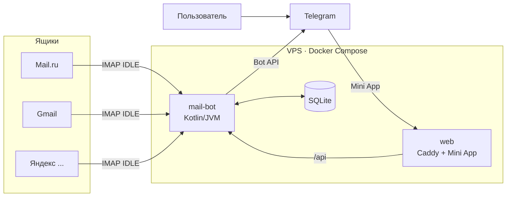

# Почта в Telegram

[English](README.md) · **Русский**

Telegram-бот, который за несколько секунд пересылает новые письма из ваших почтовых ящиков в чат Telegram. Ящики пользователи подключают сами в Mini App внутри Telegram: без паролей в чате и без конфигов, по несколько ящиков на человека.

Работает с Mail.ru (а также list.ru, bk.ru, inbox.ru), Яндексом, Gmail, Рамблером, iCloud и любой другой почтой с доступом по IMAP.

## Возможности

**Уведомления**
- Карточка на каждое новое письмо: ящик, отправитель, тема, дата, вложения.
- Кнопки под карточкой: 📄 полный текст, 📎 вложения файлами, ✅ отметить прочитанным в самом ящике.
- Новые письма ловятся через IMAP IDLE (push) плюс контрольная проверка раз в 15 секунд. Обычная задержка 5–15 секунд.
- Старые письма не пересылаются: только те, что пришли после подключения ящика.

**Mini App (внутри Telegram)**
- Подключение ящика: вводите адрес, сервис определяется сам, для каждого сервиса показана пошаговая инструкция, как создать пароль приложения.
- Статус ящика: работает, подключается или конкретная проблема (например, пароль приложения отозван).
- Смена пароля приложения без переподключения ящика: фильтры и позиция чтения сохраняются.
- **Просмотр писем:** «Входящие» и «Отправленные» каждого ящика, поиск на стороне почтового сервера по теме, отправителю и получателю, фильтры «непрочитанные» и «с вложениями», сортировка, чтение письма, отметка «прочитано», отправка вложений в чат. Письма читаются из ящика по запросу и на сервере не хранятся.
- Светлая и темная тема по теме Telegram.
- Русский и английский интерфейс: бот и Mini App говорят на языке Telegram пользователя или на языке, выбранном командой `/language` или переключателем RU / EN в приложении. Команды администратора на русском.

**Фильтры (у каждого ящика свои)**
- Пауза.
- Не присылать рассылки и автоответы (по заголовкам `List-Unsubscribe`, `List-Id`, `Precedence`, `Auto-Submitted`).
- Присылать только от: список адресов или доменов.
- Не присылать от: список адресов или доменов (поддомены тоже).
- Не присылать, если в теме есть заданные слова.

**Режимы уведомлений (у каждого пользователя свои)**
- Тихие часы: ночью письма приходят без звука, по часовому поясу пользователя.
- Сводка: письма копятся и приходят вместе раз в 1, 3, 6, 12 или 24 часа.

**Для владельца**
- `/admin` — пользователи, ящики, отправленные уведомления, состояние очереди.
- `/broadcast` — рассылка всем пользователям с предпросмотром и подтверждением.
- `/backup` и автоматический ежедневный бэкап базы SQLite, который приходит админам.
- Пользователю приходит уведомление, если ящик перестал работать, и сообщение, когда он снова в строю.

**Надежность и безопасность**
- Уведомления идут через постоянную очередь (outbox) в SQLite: ничего не теряется при перезапуске или ошибках Telegram, есть повторы с нарастающей паузой.
- Пароли ящиков шифруются AES-256-GCM. Ключ хранится только в `.env`.
- Запросы из Mini App проверяются по подписи `initData` от Telegram; каждый видит только свои ящики.
- IMAP-серверы из внутренних сетей запрещены (нельзя «прощупать» сам сервер через бота).
- Пользователь в любой момент может удалить все свои данные: `/delete_my_data` в боте или «Мои данные» в Mini App.

**Тарифы и оплата звездами Telegram** (включаются `BILLING_ENABLED=true`)
- Free: 1 ящик, уведомления, последние 20 писем в приложении, пауза, фильтр рассылок, тихие часы и сводка.
- Pro (100⭐ в месяц или 1000⭐ в год): до 5 ящиков, все фильтры, все письма с поиском и «Отправленными», коды подтверждения из писем с кнопкой «Скопировать».
- Business (300⭐ в месяц или 3000⭐ в год): до 15 ящиков и пересылка писем ящика в групповой чат команды. Ссылку на выбор группы владелец получает в настройках ящика; кнопки под письмами в группе работают у всех участников. Если бота удалить из группы, письма снова идут владельцу в личный чат.
- Новым пользователям 7 дней Pro бесплатно. Месячная подписка продлевается сама, годовая оплачивается один раз.
- Когда подписка заканчивается, работает 1 ящик (остальные можно поставить на паузу), фильтры по отправителям сохраняются, но не действуют.
- `/premium` в боте и раздел «Тариф» в приложении; `/paysupport` для вопросов об оплате.
- Админы из `.env` всегда на Business.
- Приглашение друзей: у каждого своя ссылка (`/referral` в боте или раздел «Пригласить друзей» в приложении). За каждых 5 друзей, которые впервые открыли бота по ссылке и подключили ящик, - месяц Pro (действующий платный тариф продлевается на месяц).

**Готово, но по умолчанию выключено**
- Ответ на письмо из Telegram через SMTP (`REPLY_ENABLED=true`). Многие хостинги блокируют исходящие порты SMTP 465 и 587, поэтому включайте только на сервере, где они открыты.

## Как это устроено



- **mail-bot** следит за ящиками, отправляет уведомления, обрабатывает кнопки и команды и отдает API для Mini App.
- **web** — Caddy с автоматическим HTTPS-сертификатом: раздает Mini App и проксирует `/api` в бота.

## Что понадобится

- VPS с Ubuntu 22.04/24.04, **1 ГБ RAM** и больше (желательно 2 ГБ swap), открытые порты 80 и 443.
- Домен или бесплатное имя `sslip.io` по IP сервера (например, `203-0-113-10.sslip.io`).
- Токен бота от [@BotFather](https://t.me/BotFather).

## Быстрый запуск (около 15 минут)

**1. Создайте бота.** В @BotFather: `/newbot`, скопируйте токен.

**2. Подготовьте сервер.**
```bash
curl -fsSL https://get.docker.com | sh
git clone https://github.com/LightSmit/mail-to-telegram-bot.git
cd mail-to-telegram-bot
cp .env.example .env
```

**3. Заполните `.env`.** Минимум:
```dotenv
TELEGRAM_BOT_TOKEN=123456:ABC...
ENCRYPTION_KEY=        # openssl rand -base64 48
DOMAIN=203-0-113-10.sslip.io
TELEGRAM_CHAT_ID=      # ваш Telegram ID: вы станете админом
```
Сохраните копию `ENCRYPTION_KEY` в менеджере паролей. Без него сохраненные пароли ящиков не расшифровать.

**4. Запустите.**
```bash
docker compose up -d --build
docker compose logs -f mail-bot
```
Первая сборка занимает 2–4 минуты.

**5. Подключите Mini App.** В @BotFather: `/mybots` → ваш бот → `Bot Settings` → `Menu Button` → `https://<DOMAIN>`.

**6. Проверьте.** Напишите боту `/start`, откройте приложение, подключите ящик и отправьте себе письмо.

## Настройки

Все настройки в `.env` (см. [.env.example](.env.example)).

| Переменная | По умолчанию | Зачем |
|---|---|---|
| `TELEGRAM_BOT_TOKEN` | — | Токен бота, обязательно |
| `ENCRYPTION_KEY` | — | Ключ шифрования паролей ящиков (от 32 символов), обязательно |
| `DOMAIN` | — | Домен Mini App для Caddy и кнопки «Открыть приложение» |
| `MINI_APP_URL` | `https://<DOMAIN>` | Адрес Mini App, если он отличается |
| `TELEGRAM_CHAT_ID` | — | Telegram ID владельца, всегда админ |
| `ADMIN_IDS` | — | Другие админы через запятую |
| `IMAP_SAFETY_POLL_SECONDS` | `15` | Контрольная проверка через новое подключение (каждая - новый вход в ящик) |
| `IMAP_NOOP_SECONDS` | `5` | NOOP в открытом IDLE-соединении |
| `IDLE_RECONNECT_DELAY_SECONDS` | `5` | Базовая пауза перед переподключением (при ошибках растет) |
| `MAX_ATTACHMENT_SIZE_MB` | `45` | Вложения больше этого в Telegram не отправляются |
| `BACKUP_HOUR` / `BACKUP_KEEP` | `4` / `7` | Час ежедневного бэкапа и сколько копий хранить |
| `BACKUP_SEND_TO_ADMINS` | `true` | Присылать файл бэкапа админам |
| `REPLY_ENABLED` | `false` | Кнопка «Ответить» (нужен открытый исходящий SMTP 465/587) |
| `BILLING_ENABLED` | `false` | Тарифы и оплата звездами. Пока `false`, у всех лимиты Pro |
| `TRIAL_DAYS` | `7` | Пробный Pro для новых пользователей, дней (0 - без пробного) |
| `PRICE_PRO_MONTH` / `PRICE_PRO_YEAR` | `100` / `1000` | Цены Pro в звездах |
| `PRICE_BUSINESS_MONTH` / `PRICE_BUSINESS_YEAR` | `300` / `3000` | Цены Business в звездах |
| `REFERRAL_GOAL` | `5` | Сколько друзей нужно пригласить за месяц Pro (0 - приглашения выключены) |
| `SUPPORT_CONTACT` | — | Контакт для вопросов об оплате (`/paysupport`), например `@username` |
| `TELEGRAM_PROXY_URL` | — | HTTP-прокси только для Telegram Bot API, если Telegram заблокирован |
| `ENCRYPTION_KEY_LEGACY` | — | Прежний ключ, только для переноса старых записей |

## Команды бота

| Команда | Кому | Что делает |
|---|---|---|
| `/start` | всем | Приветствие и кнопка «Открыть приложение» |
| `/help` | всем | Как все работает и как подключить ящик |
| `/mailboxes` | всем | Ваши ящики и их состояние |
| `/language` | всем | Выбрать язык бота (русский или английский) |
| `/premium` | всем | Тариф, срок подписки и кнопки оплаты |
| `/paysupport` | всем | Куда писать по вопросам оплаты |
| `/referral` | всем | Своя ссылка-приглашение и счетчик друзей |
| `/delete_my_data` | всем | Удалить все свои данные из бота (с подтверждением) |
| `/admin`, `/stats` | админам | Статистика |
| `/broadcast текст` | админам | Подготовить рассылку; `/broadcast_send` отправить, `/broadcast_cancel` отменить |
| `/backup` | админам | Сделать бэкап базы сейчас |
| `/grant ID тариф срок` | админам | Выдать подписку: `pro` или `business`, срок `7d`, `1m`, `3m`, `6m`, `1y` или `forever`. Вместо ID можно `@username` |
| `/revoke ID` | админам | Отозвать любую подписку (и отменить автопродление Stars) |
| `/invite тариф срок` | админам | Одноразовая ссылка с подпиской, например `/invite business forever` |
| `/refs` | админам | Кто сколько друзей пригласил |
| `/subs`, `/users` | админам | Действующие подписки; последние пользователи с ID и тарифом |
| `/refund ID` | админам | Вернуть звезды за последнюю оплату и отозвать подписку |

## Обновление и бэкапы

```bash
git pull
docker compose up -d --build
```

Бэкап базы делается автоматически каждый день. Ручная копия тома с данными:
```bash
docker run --rm -v mail-to-telegram-bot_mail-bot-data:/data -v "$PWD":/backup alpine \
  tar czf /backup/mail-bot-data-$(date +%F).tar.gz /data
```

## Разработка

- Бэкенд: Kotlin 2, JVM 21, Ktor (сервер и клиент), Jakarta Mail (Angus), SQLite + HikariCP, kotlinx.coroutines, jsoup.
- Фронтенд: React 19, TypeScript, Vite, `@twa-dev/sdk`.
- Инфраструктура: Docker Compose, Caddy.

```bash
./gradlew test        # тесты (Windows: .\gradlew test)
./gradlew run         # запуск бота локально с .env из папки проекта
cd frontend && npm ci --legacy-peer-deps && npm run dev
```

```text
src/main/kotlin/io/github/lightsmit/
├── api/        HTTP API для Mini App, проверка initData Telegram
├── config/     настройки, модель ящика
├── mail/       IMAP (IDLE, загрузка, поиск), SMTP, разбор писем
├── security/   шифрование паролей AES-256-GCM
├── service/    пересылка, фильтры, расписание, админка, бэкапы, здоровье ящиков
├── storage/    репозитории SQLite, outbox
└── telegram/   клиент Bot API, кодирование кнопок
frontend/       Mini App (React)
deploy/         Caddyfile
```

## Ограничения

- Gmail иногда поздно сообщает о новых письмах по IMAP; с `IMAP_SAFETY_POLL_SECONDS=15` задержка около 10–15 секунд. Мгновенная доставка возможна только через Gmail API с OAuth.
- Outlook / Hotmail не поддерживаются: Microsoft пускает по IMAP только через OAuth.
- Поиск писем работает по теме, отправителю и получателю (IMAP SEARCH почтового сервера), а не по тексту письма.
- Для ответа из Telegram нужен исходящий SMTP, см. `REPLY_ENABLED`.

## Лицензия

Все права защищены. Использование, копирование и распространение только с письменного разрешения автора, см. [LICENSE](LICENSE).

© 2026 Матвей ([LightSmit](https://github.com/LightSmit))
